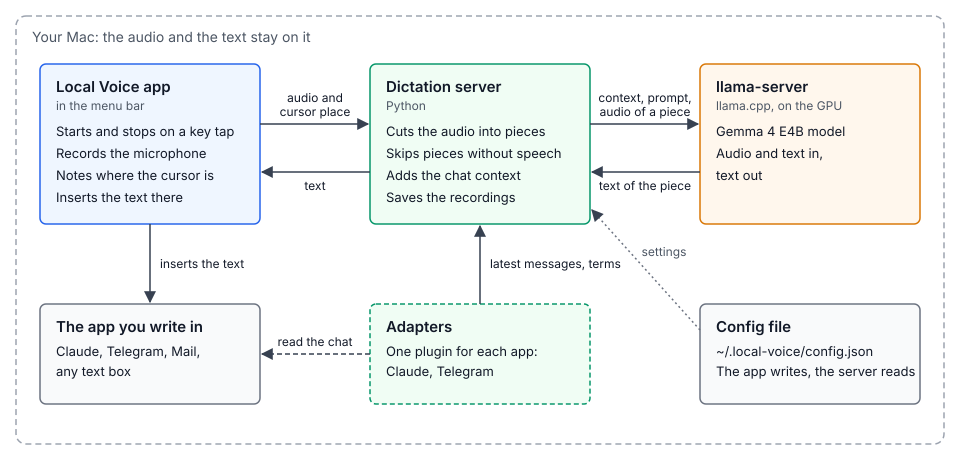

# Local Voice

**Speak your language. Keep your English terms.**

Local dictation for Mac, built for conversations where your language and English technical terms naturally mix.

[Download for Mac](https://github.com/wowgs/local-voice/releases) · [User guide](docs/reference/4-app.md) · [Documentation](docs/README.md)

## How it works

You might say: *«Посмотри этот pull request и проверь, почему падает build».* That's how you work. Your dictation should fit that.

**The conversation comes first.** Local Voice puts recent messages before your audio as context for the speech model. It gets a sense of what you're discussing before it transcribes what you say.

**Your language stays in focus.** The recognition prompt explicitly asks for your chosen language. The conversation provides more examples of that language in use, alongside the English words you work with.

**English terms get their own space.** Names, tools, and identifiers from the conversation also appear in a short, separate term list. This gives the model their written forms to help recognize them in your speech.

Context is available in **Claude Desktop's Code tab** and **Telegram Desktop**. In other apps, Local Voice works without conversation context. [More about context and adapters →](docs/reference/3-context.md)

## All on your Mac

Gemma 4 E4B runs locally through bundled llama.cpp. Pick a model variant in the app, click **Download**, and you're ready to dictate offline.

Tap **right Option** to speak; tap again to insert the text. Use **right Command** for private dictation, without conversation context or saved recordings.

Regular dictations save audio, text, and context locally by default; saving can be turned off in Settings. [Recording privacy →](docs/reference/5-recordings.md)

Apple Silicon · macOS 13+ · 16 GB memory minimum. [Setup and model choices →](docs/reference/4-app.md#requirements-and-model-choices)

[How recognition works](docs/reference/1-server.md) · [Build and develop](docs/reference/7-development.md) · [All documentation](docs/README.md)
