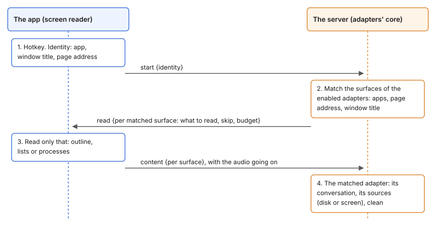

# Adapter surfaces

This page is the design of adapter interface 3: an adapter is a product, and its surfaces say where the product is on the screen and what is read there. Both sides are built. The app's side has the identity, the read request's content, the outline's fixes and the settings window. The server's side has the manifests with surfaces, the matching, the read request, the adapters' code of interface 3 and the test client's recorded snapshot. The adapters are in [the context reference](reference/3-context.md), and the decisions of the whole app are in [Design](design.md#adapters). The work is in [the plan](plan.md#structure).

## Why

In interface 2 an adapter is both a product for the user and the rules for one app's window. The facts below follow from that (code of commit 2932db7):

- The core asks every enabled adapter about every window. It does not use the manifest's `apps`, so each adapter checks the bundle id again with its own constant.
- The client reads the outline of an app with the union of the `outlineSkip` of all its adapters and with the largest of their budgets. One adapter's needs change another adapter's input. For example, `claude-code` needs only the path of the open file from the screen, but it reads the screen with the budget of the chat's messages.
- `claim` and `context` find the same conversation twice. For a terminal, the store of running sessions is read twice.
- The client sends the window title, the ancestors of the focused element, their addresses and the processes with their folders for any app of an enabled adapter. No manifest declares this, and no built-in adapter uses the folders.
- The settings window cannot show what is read in each app: `screenApps` is one list for every kind of screen data, and `reads` is a flat list.
- A product on a new surface needs a new adapter. Claude Code in a browser (`claude.ai/code`) has no transcript on the disk; for the user it is still Claude Code.

## Decisions

- **An adapter is a product.** It is what the user writes into: Claude Code, Claude chats, Telegram. The user turns it on and sets it up as one thing.
- **A product has surfaces.** A surface is a place where the product is on the screen: the Code tab of Claude Desktop, a terminal's tab, a browser's tab on a site. Each surface has its own sources of context: a transcript on the disk, a file on the disk, the text on the screen.
- **The snapshot has two phases.** First the identity: a small fixed set of fields that tell which app, window and page it is. Then the content: only for a surface that matched, and only what that surface declares, with its own skip list and its own budget.
- **The rules of a surface are declarative**, in the manifest: the apps, the page's address, the window's title. The core checks them, not the adapter's code. So a browser is read only on the sites of a matched surface, never on every site.
- **The identity is fixed by the core** and shown once to the user. Everything else (the outline, lists, processes) is read only when a surface declares it.
- **The settings window shows each adapter by its surfaces**: one section per surface, with what is read from the screen and from the disk.
- **`hints` go.** The start message carries no hints, and no adapter reads them. The test client sends a recorded snapshot instead.
- **The server's entry point, logger and logs are named `echofox-server`.**

## The flow



Blue is the app, orange is the server, arrows are messages on the recording's connection. The boxes have no scale in time.

1. At the hotkey, the app reads the identity of the focused app (below) and sends it in the start message. The recording starts at once, as now.
2. The server matches the identity with the surfaces of the enabled adapters and answers with a read request: for each matched surface, what to read and how.
3. The app reads only that and sends it in a content message. The audio goes on meanwhile.
4. The adapter of the matched surface finds the conversation, reads its sources and gives the context. The context's deadline is the recording's stop, as now.

A private dictation sends no identity, gets no read request and reads nothing of the screen.

## Proposal: the details

Everything in this section is Claude's proposal: field names, the protocol messages and where the matching runs.

### Where the matching runs

The server matches; the app only reads what it is asked to read. The cost is one round trip on the local connection before the content is read. Not measured; the read itself took 49 to 562 ms in the logs ([observations](observations.md#token-estimate-and-screen-reading)).

The other option was to match in the app with the rules from the server's info. It saves the round trip, but the rules and the budgets are then resolved in Swift and in Python, which is the duplication that this design removes.

### The identity

The core reads the same fields for every app of an enabled adapter's surfaces, and nothing for other apps:

| Field | What |
|---|---|
| `app` | `bundleId`, `pid`, `name`, and `version`: its `CFBundleShortVersionString`, read from its `Info.plist` on the disk |
| `window` | `title` of the focused window |
| `webArea` | `url` and `title` of the nearest web area above the focused element, if any |

The ancestors of the focused element are read to find the web area, and are not sent. `window.document` and `focused` are not sent: no adapter uses them. The app finds the text box for the insertion on its own, as now.

### The manifest (interface 3)

```json
{
  "name": "claude-code", "title": "Claude Code", "version": "3.0", "author": "echofox",
  "source": "https://github.com/wowgs/echofox", "description": "…", "interface": 3,
  "surfaces": [
    {"id": "desktop", "title": "Claude Desktop, Code tab",
     "apps": ["com.anthropic.claudefordesktop"], "treeOnRequest": true,
     "match": {"url": "https://claude.ai/epitaxy/*"},
     "screen": {"outline": {"skip": ["epitaxy-document-page", "group/file-tree", "epitaxy-chat-panel-body"]}},
     "reads": [{"path": "~/Library/Application Support/Claude/claude-code-sessions", "what": "The session's record"},
               {"path": "~/.claude/projects", "what": "The session's transcript"},
               {"what": "The Markdown file open in the Files panel, from the session's folder"}]},
    {"id": "terminal", "title": "Terminal tab",
     "apps": ["com.mitchellh.ghostty", "com.apple.Terminal", "com.googlecode.iterm2", "dev.warp.Warp-Stable"],
     "screen": {"processes": {}},
     "reads": [{"path": "~/.claude/sessions", "what": "The running sessions"},
               {"path": "~/.claude/projects", "what": "The session's transcript"}]}
  ],
  "context": {"chatHistoryTokenBudget": 1000, "chatTermsTokenBudget": 200}
}
```

| Field of a surface | What |
|---|---|
| `id` | Unique within the adapter. The core names it `<adapter>/<id>`. |
| `title` | For people, in the settings window. |
| `apps` | Bundle ids. Required. |
| `treeOnRequest` | The apps build their accessibility tree only on request (Electron, Chromium). The app asks them for it, as `electronTree` does now. |
| `match` | Optional. `url`: a pattern of the web area's address. `title`: a pattern of the window's title. In a pattern, `*` is any text and every other character is itself. All given fields must match. |
| `screen` | What is read after a match. `outline`: the tree of the page or window, with `skip` (as `outlineSkip` now) and `budget`, the key of the adapter's knob that limits the text (`chatHistoryTokenBudget`); without `budget`, only the structural limits apply. `lists`: the rows of the window's lists, with `budget`. `processes`: the app's child processes (`pid`, `name`). |
| `reads` | The files it reads: `path` if it is a fixed place, and `what` it is. |

Patterns with `*` only, not regular expressions: they read the same for people, and the Python and Swift dialects of regular expressions differ.

The other two adapters:

- `claude-chat`: one surface, `desktop`. Claude Desktop, `treeOnRequest`, `url` `https://claude.ai/chat/*`, `outline` with its skip list and `budget` `chatHistoryTokenBudget`.
- `telegram`: one surface, `desktop`. Telegram Desktop, `lists` with `budget` `chatHistoryTokenBudget`.

A later surface of `claude-code`, `web`: Chrome, `treeOnRequest`, `url` `https://claude.ai/code/*`, `outline` with a budget, and no `reads`.

### The protocol (interface 3)

```text
app → server  {"type": "start", …, "identity": {"app": {…}, "window": {…}, "webArea": {…}}}
server → app  {"type": "read", "surfaces": [{"surface": "claude-code/desktop",
                 "outline": {"skip": […], "budget": 1000}, "lists": null, "processes": null}],
                 "tokenWeights": {…}}
app → server  {"type": "content", "surfaces": {"claude-code/desktop": {"outline": {…}}}, "tookMs": 64}
```

- `start` no longer has `snapshot` and `hints`.
- The server answers `read` at once, before it loads the model. With no matched surface, `surfaces` is empty and the app sends no `content`.
- The budget is resolved on the server, from the config's entry, the manifest and the knob's default. The app gets a number and the model's weights to count with, so the app no longer resolves budgets.
- The `content` message can come between audio messages.
- When several surfaces match, the app reads each with its own rules. Overlapping surfaces should be rare: the built-in ones are told apart by the address.

### The adapter's code (interface 3)

```python
class Adapter(abc.ABC):
    def context(self, surface, snapshot):
        """The context of the conversation on this surface (its id), or None: not found for sure."""
    def clean(self, text):
        """A message's or a document's text as plain prose for the model."""
```

- `snapshot` is the identity and the content of that surface. `context` returns the same fields as now: `about`, `messages`, `documents`, `terms`, `source`, `details`.
- `claim` goes: the declarative match replaces it, and a found conversation replaces the confidence. If more than one adapter gives a context, the dictation goes without context and the log names them. This follows the rule "when it is not certain, no context is used".
- The core gives the adapters vendor-neutral helpers for the snapshot: the web area, the window's title, the walk of the outline by depth, the processes. The adapters stop copying them.
- The sources stay in the adapter. Every change of a message's text goes through `clean`.

### The outline

- The skip list is checked against all DOM classes of an element. Only the copy sent is cut to 12 classes. Now the classes are cut first: in a snapshot of Claude Desktop some elements had 12 of them, so a class after the 12th never matches a skip.
- A skipped element stays in the outline with `"skipped": true`, without its children. Adapters read that flag instead of deciding again by role and class.
- When the budget stops the walk, the outline still includes the ancestors of the last element read. So the oldest element on the screen can be told apart and taken whole.
- The walks of the outline and of the lists stop after 10,000 elements, and they leave out a child that is one of its own ancestors. The budget counts only text, and a surface may have no budget. The application element of Claude Desktop and of Finder was its own child (2026-11-02). [The context reference](reference/3-context.md#what-the-app-reads) has the rule and the measurements.

### The settings window

An adapter's page shows one section per surface: its title, its apps, its `match`, what is read from the screen, and its `reads`. The identity is described once, on the context page, for all adapters.

## Checks and tests

- Shared examples in `shared/` for both sides: identities with the surfaces that must match, the read requests, and the token estimate of sample texts with its expected counts.
- Hand-written snapshots in the adapters' tests, which CI runs.
- Fixtures from live windows: real snapshots of each surface, of test conversations on this Mac, with the parse that the owner accepted. They stay on this Mac, and a tool checks them again after an app update ([fixtures](reference/8-fixtures.md)).

## Assumptions and open questions

- Not measured: the round trip of the read request on the local connection.
- Not checked: that Chrome gives the web area's address through Accessibility and needs `AXEnhancedUserInterface` for its tree, as Electron does.
- Not checked: that Claude Code's title in a terminal always starts with `✳`. If it does, the terminal surface can match by title, and processes are read only for those windows.
- Not measured: the source view of the Files panel. If the file's text is not inside `epitaxy-document-page`, the skip list needs its element too.
