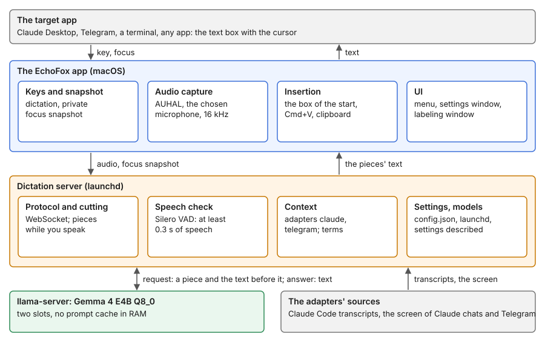
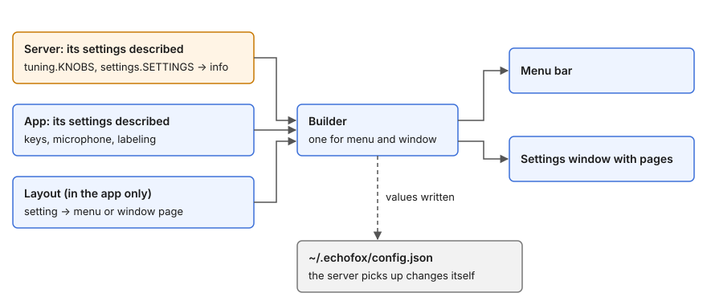

# Design

This page explains the product decisions and the architecture of EchoFox. The [README](../README.md) is for users. The [reference](README.md#use-and-configure-the-app) describes the current behavior in detail. The [requirements](requirements.md) list the target behavior, and the [observations](observations.md) record the measurements behind the decisions.

## Who it is for

The first user works on a Mac with AI assistants and chats. They often dictate in Russian and use English names and technical terms. They want to speak in the window where they work, without a separate program, and without sending audio to a cloud service.

What they get:

- Dictation into the app they use. A key starts the recording, the same key stops it, and the text goes into the text box.
- Local recognition. After the model download, no internet is needed.
- Context from the conversation. An adapter gives the model the names and terms of the current chat, in the apps that have one.
- Private dictation on a key of its own, without context and without saved recordings.

The gain from the context on mixed speech is not measured yet, and no comparison with cloud dictation exists. So the product does not promise "error-free recognition" or "understands any conversation". It says that the context comes from specific adapters, and that regular dictations are saved on the Mac by default.

## Decisions

- macOS on Apple Silicon. Dictation works through system features. EchoFox does not change the target apps.
- One model catalog. Now it has Gemma 4 E4B in two variants, Q4_0 and Q8_0.
- One app package without the model. The model is downloaded from the app.
- Adapters are optional. When the conversation is not certain, the dictation runs without context.
- The keys are toggles, not hold-to-talk.
- A short menu for frequent actions. All other settings are in the settings window.
- The server owns recognition and models. The app owns recording, the interface and insertion.
- Each setting has one owner and one way to set it (see [Settings](#settings)).
- The core knows no vendor. Everything about one app lives in its adapter.

## Architecture

Blue is the app, orange is the server, green is the model. Arrows show the data. The sizes of the blocks mean nothing.

Three processes run:

- **The Mac app.** The interface, the keys, the microphone, Accessibility and insertion. macOS gives the permissions to this process.
- **The dictation server.** The app's child process. It receives the audio, chooses an adapter, sends requests to the model and saves the results. The protocol is in the [protocol reference](reference/6-protocol.md).
- **llama-server.** The dictation server's child process, for the chosen model. Only the chosen model is in memory, and only while it is used: after `modelIdleSeconds` without a dictation (600 s by default, 0 keeps it) the server ends it. The next dictation records at once; the server reads the conversation and loads the model meanwhile, then sends the text before the audio (prefill), then the pieces of audio that waited.

EchoFox is one app: the processes run while it runs. The app starts the server when it opens. Quit ends the server, and the server ends its llama-server, so the model leaves memory. If the app ends in any other way, the server sees its standard input close and ends too. If the server ends while the app runs, the app starts it again: at once after a server that ran a while, and with a wait that doubles up to 60 seconds after one that ended at its start. Nothing starts at login. A llama-server that a killed server left behind is stopped by the next server before it starts its own. Older versions ran the server and the model as launchd agents without the app; the app removes those agents at its start.

In the distributed app, the server, Python and llama-server are inside `EchoFox.app`; see [the package](reference/7-development.md#the-package).

Inside the app, the decisions live in `EchoFoxCore`, which needs no screen and has checks: the config's one owner (`ConfigStore`, which also notices edits made elsewhere), where the text goes (`InsertionRule`), which snapshot an app gets, which microphone the config means. The `EchoFox` target does what macOS must do for them, for example `Inserter` carries out `InsertionRule` through Accessibility. The app and the server agree through two files that the tests of both sides read: the protocol's examples (`shared/protocol-examples.json`) and the values both use before they can talk (`shared/constants.json`). Everything else the app learns from the server's info.

| Component | Responsibility | Reference |
|---|---|---|
| Keys and menu | Start and stop, state, settings | [App](reference/4-app.md) |
| Audio capture | The chosen microphone, 16 kHz, 16-bit, mono, through AUHAL | [App](reference/4-app.md) |
| WebSocket | One recording per connection: start, audio, stop, results | [Protocol](reference/6-protocol.md) |
| Dictation server | Speech detection, cutting, the prompt, model requests | [Server](reference/1-server.md) |
| Adapters | Find the current conversation and its context | [Context](reference/3-context.md) |
| Insertion | The current text box, the box of the start, or the clipboard | [App](reference/4-app.md#where-the-text-goes) |
| Models | Catalog, download, removal, the llama-server process | [Server](reference/1-server.md#the-catalog-and-the-downloads) |
| Storage | Config, recordings, labels, logs, metrics | [Recordings](reference/5-recordings.md) |

### Why the audio is cut into pieces

The model takes at most 30 seconds of audio per request. The server sends finished pieces while the person still speaks, and handles the rest after the stop. Two model slots let two pieces run at once. Silero VAD decides whether a piece has speech. The audio level helps to choose a quiet place for a cut, but it does not replace the VAD. A speech threshold and a limit on the answer's length protect against invented text on silence and endless generation. The values are in the [server reference](reference/1-server.md).

## Settings

Each setting has an owner: the component that defines what it means and its default. The user's change is stored at the same owner.

| Owner | Defaults | The user's changes in the config |
|---|---|---|
| Adapter | `adapter.json`, field `context` | `adapters.<name>` |
| Model | `server/catalog.json` | `models.<name>.prompt`, `models.<name>.options` |
| Language | `server/languages.json` | `languages.<code>` |
| Server | `server/tuning.py` | `server` |
| App | the Swift code | the top level of the config |

The order: an experiment's start options, then the user's change, then the owner's default. Limits of the model, such as the longest audio, apply in any case. The app sends no experiment options; only the test client does.

Common settings are shown at once, and fine tuning is under Advanced. Protective constants are not settings. The prompt template belongs to the model, and the language notes belong to the language, so a new template keeps the notes. An adapter is turned off with `enabled`, not with a budget of 0. The keys are in the [config reference](reference/2-config.md) and in the schema, `shared/config.schema.json`.

### The config file over versions

The file must stay readable by an older and a newer EchoFox: a rollback, a local build next to the installed app, and a test server all read the same `~/.echofox/config.json`. So:

- **The file holds only the user's choices.** A default is never written to it; a value equal to the default takes the key out. A new default applies by itself, with no change to the file.
- **A reader takes each key on its own.** It uses the keys it knows, leaves out a key it does not know, and replaces a wrong value with the default of that key alone. It never drops the whole file. A writer keeps the keys it does not know.
- **A key keeps its meaning.** Its type, unit and meaning never change. A new meaning is a new key (`maxRecordingSeconds`, not minutes under the old name); a key that is no longer used is left out by readers and stays in the file.
- **One writer.** Only the app writes the file, one key at a time, in place (`Config.set`). The server only reads it.
- **`version` is the format.** It changes only for a change that a reader that leaves out unknown keys would get wrong, which these rules avoid. A file of a newer format is read key by key as above, with a note in the log and on the settings window. A file of a format before 11 is brought to 11 once by the server, after it copies the file to `config.json.v<N>.bak`; that is the only time the server writes the file.
- **One schema.** `shared/config.schema.json` (JSON Schema) lists every key, its type and its owner. The server's tests check its settings against it, and the app's tests check the keys that the app reads and writes.

A setting's meaning is separate from its place. The server sends the settings of the server, the models and the adapters in its info; the app's own settings are described in Swift. `SettingsLayout.swift` puts each setting on a page, in a section and in an order; a new server setting without a line there goes to the page of its owner. The window changes one value in `~/.echofox/config.json` and keeps the file's formatting (`JSONEdit.swift`). The server picks up the change by itself. Blue is the app, orange is the server, gray is the config; the dashed line is a write.

A setting has the owner's default and an optional change by the user. A reset removes the change from the config. A value equal to the default does not count as changed. The same rule drives the "2 changed" counter, the reset button and the "Set here." note (`SettingStore.swift`). An empty number field shows the default in gray, and the allowed range appears with a wrong value.

## Interface

What the menu, the keys and the settings pages do is in the [app reference](reference/4-app.md). The decisions behind them:

- The menu holds only what is touched often: the missing permissions, the microphone and its volume, labeling, settings, quit. `SettingsLayout.menu` sets its order, `MenuBar.swift` shows it.
- The menu bar icon shows the state with a fox face ([the art](../macos/art/README.md)); a problem keeps the crossed-out microphone until a fox for it is drawn.
- Two keys, the right Option for regular and the right Command for private dictation, each a single tap. Conflicts with other apps' keys are possible, and no way to detect them is chosen yet.
- A value applies on Return or when the field loses focus; the window remembers the last page and the open sections.

## Adapters

An adapter adds the context of the app: recent messages, names and terms. Without adapters, EchoFox still recognizes speech and inserts the text. The supported apps, the adapter format and the checks are in the [context reference](reference/3-context.md).

- **Optional.** No matching adapter, or no exact match with the conversation, means a dictation without context.
- **One platform, its own adapter.** Paths, transcript formats and screen rules of an app stay in its adapter. The core has no vendor logic.
- **The conversation comes from the current window.** The newest session is not always the one the person dictates into. When it is not certain, no context is used.
- **Access is visible.** The manifest lists the apps, the files and the screen data that the adapter needs. The client takes the Electron accessibility tree and the screen content (the rows of lists, or the outline of a page) only for the apps of enabled adapters that ask for them. A config migration never turns on an adapter that reads the screen.
- **Private dictation skips the adapters.**
- **Adapters run with the user's rights.** The checks of the manifest and the interface version are not an isolation of the code.

The help of context on recognition is not measured on a labeled set yet, so the product does not promise that an adapter improves accuracy.

Proposed, not built: installation from a GitHub link and a catalog of adapters, a hint to enable an adapter for a detected app, the source of the last context in the menu, adapters in other languages through a separate process.

## Privacy

onnxruntime sends Microsoft telemetry on macOS by default. `server/vad.py` turns it off before the library loads (`ORT_DISABLE_TELEMETRY=1`, then `disable_telemetry_events()`); only `vad.py` imports onnxruntime. llama-server is built without OpenSSL and curl and runs with `--offline --no-webui`. The app opens only the WebSocket to the dictation server. The internet is used for the model downloads and, for the update check and its download ([updates](reference/7-development.md#updates)); nothing of a dictation leaves the Mac ([NFR-14](requirements.md)).

Proposed: a release check that runs the package on a test recording and fails on an unexpected connection.

## Open questions

- How to match a window with Claude Code in a terminal or in VS Code.
- How to detect conflicts of the chosen keys with the system and other apps.
- The recording indicator: a 3D fox over the window of the dictation that peeks out, listens and turns its head, takes no focus and lets clicks through; optional. RealityKit renders it (the oldest macOS, 26, has all of RealityKit); the character is a rigged USDZ model with animation clips, and the code turns its head. A prototype of the transparent rendering exists (`macos/prototypes/transparent-realitykit-overlay.swift`). Next: a check of the pipeline with a ready rigged model (clips, a turned head, the GPU cost beside the model), then the character.
- The public product's scope for the first public version.
