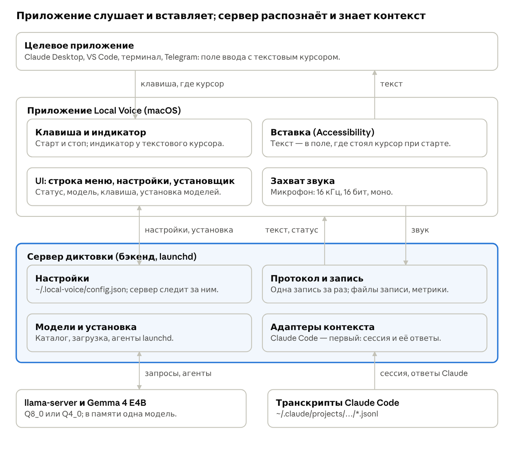

# 4. HLD

Архитектура по слоям, без выбора технологий. Технологии — отдельным шагом. Ссылки FR и NFR — на вкладку 2.

## Слои (предложение)

1. **Триггер и индикатор** — приложение. Горячая клавиша начинает и кончает запись (FR-1); в момент нажатия приложение делает снимок фокуса (см. «Разговор на экране»). Индикатор — 3D-маскот поверх окна, где нажата клавиша (FR-6), статус в строке меню (FR-7).
2. **Захват звука** — приложение. Микрофон, 16 кГц, 16 бит, моно, кусками на сервер по ходу записи.
3. **Транспорт** — один WebSocket к серверу на запись, протокол уже есть (README, раздел о протоколе): старт с моделью, языком и приложением; звук; стоп. В ответ признаки речи, текст по кускам, конец.
4. **Распознавание** — сервер и `llama-server`. Нарезка, текст перед звуком, кусок как отдельный запрос, одна модель в памяти (FR-2, NFR-5). Это уже работает.
5. **Адаптеры контекста** — сервер (FR-3, NFR-3). Ядро отдаёт запись одному адаптеру (см. «Разговор на экране»); адаптер находит сессию и строит контекст: последние ответы и термины в пределах бюджета токенов. Адаптеры — необязательные плагины: без включённых диктовка идёт в базовом режиме, без контекста; один плагин на платформу, ядро не знает ни одного вендора; встроенный пока один — `server/plugins/claude` (вкладка Code в Claude Desktop через хранилище Desktop и сессии Claude Code, которые называет клиент); пользовательские — из папки (решение Алекса, 15 октября; подробно — документ «Local Voice: optional adapters»). Снимок собирает библиотека `FocusSnapshot` в `macos/`, полный — только для приложений включённых адаптеров.
6. **Вставка** — приложение. Accessibility, в запомненное поле (FR-1). Если вставка не удалась, текст остаётся в истории (FR-9, NFR-7).
7. **UI** — приложение: строка меню, окно настроек, установщик (FR-4, FR-5, FR-8 — FR-13). UI ничего не делает сам: читает и пишет конфиг и шлёт команды серверу.
8. **Установка и жизненный цикл** — сервер. Каталог поддерживаемых моделей (файл в репозитории), загрузка с прогрессом, агенты launchd для `llama-server` каждой модели, реестр в конфиге (FR-4, FR-13). Для UI — служебные команды сервера: каталог, установить, удалить, состояние.
9. **Хранилище** — конфиг `~/.local-voice/config.json`, записи `~/speech/recordings`, метрики и журналы `~/Library/Logs/local-voice` (FR-10, FR-11).

## Процессы (предложение)

- **Приложение** — один процесс: UI, клавиша, звук, вставка. Один процесс — одна запись в разрешениях macOS.
- **Сервер диктовки** — агент launchd; слои 4, 5, 8 и протокол.
- **`llama-server`** — агент launchd на каждую модель; работает только выбранная.

Сервер — внутри пакета приложения, вместе со своей средой Python и собранным `llama-server`; модель пользователь загружает из UI (решение Алекса, 15 октября). Сборки: без модели и с каждой из моделей каталога (решение Алекса).

Как собирать (предложение): модель не кладётся внутрь `.app` — пакет на 5–9 ГБ тяжело подписывать, нотаризировать и обновлять, и с каждым обновлением приложения пришлось бы заново качать модель. Сборка без модели качает её из UI в `~/Library/Application Support/Local Voice/models`; сборка с моделью — тот же `.app` и файл модели рядом в `.dmg`, приложение при первом запуске берёт модель оттуда. Для нотаризации подписывается каждый бинарник внутри пакета (Python, `llama-server`).

Выпуск и обновления: обновления через Sparkle (решение Алекса, 15 октября). Остальное — предложение: код открыт на GitHub; сборку для раздачи подписываем сертификатом Developer ID (нужна платная Apple Developer Program; когда её брать — решает Алекс) с усиленным рантаймом и правом на микрофон, нотаризуем (`notarytool`, `stapler`), раздаём `.dmg` в GitHub Releases; лента обновлений Sparkle (`appcast.xml`) подписана своим ключом EdDSA. С Developer ID разрешения macOS переживают обновления: требование к коду — bundle id и Team ID, а не хеш бинарника. Mac App Store не подходит: там обязательна песочница, а приложению в ней, насколько известно, Accessibility к чужим приложениям не даётся (не проверено). На время разработки — самоподписанный сертификат: с подписью ad hoc каждая пересборка меняла хеш, и macOS отказывала в уже выданном Accessibility (журнал `tccd`, 15 октября).

## Разговор на экране (решение Алекса, 15 октября)

Нажатие клавиши глобальное, а разговор у каждого целевого приложения свой. Поэтому работа делится на три шага:

1. **Снимок фокуса — ядро, приложение.** В момент нажатия приложение один раз и одинаково для всех собирает через Accessibility и систему: bundle id и pid фронтового приложения, заголовок окна, элемент с курсором и цепочку его родителей (роли, заголовки, описания, `AXDocument` или URL, если есть), процессы под окном и их рабочие папки. Снимок едет на сервер в `start`. Адаптеры сами на экран не смотрят: права Accessibility есть только у приложения, а снимок нужен мгновенно, пока фокус не ушёл.
2. **Выбор адаптера — ядро спрашивает все адаптеры.** У каждого адаптера дешёвая проверка «моё или нет» по снимку, с уверенностью. По одному приложению выбрать нельзя: в VS Code бывают и Claude Code, и Codex, в терминале — и `claude`, и `codex`. Ядро отдаёт запись самому уверенному; если не взял никто — диктовка без контекста. При споре — ручная привязка в UI: «это приложение → этот адаптер».
3. **Сессия и контекст — только выбранный адаптер,** по тому же снимку и по своим источникам.

Следствие для NFR-3: снимок должен с самого начала быть достаточно полным, чтобы новым адаптерам хватало его без изменений приложения.

## Что даёт снимок: замер 15 октября (факт)

Условия: этот Мак, macOS 27.0.1, Claude Desktop 2.37337.1, Ghostty, Telegram, Chrome; один снимок на приложение. VS Code не был запущен — не проверен.

- **Claude Desktop (Electron).** Без `AXManualAccessibility = true` у приложения видно только окно «Claude», элемента с курсором нет. С ним: элемент с курсором — `AXTextArea`, описание `Prompt`, классы DOM `tiptap ProseMirror`; в родителях классы `epitaxy-chat-panel`, `dframe-pane-primary`. На 26-м уровне вверх — веб-область с `AXURL = https://claude.ai/epitaxy/local_<id>` и `AXTitle = <название сессии> - Claude Code`.
- **Хранилище Desktop.** `~/Library/Application Support/Claude/claude-code-sessions/…/local_<id>.json` содержит `cliSessionId` (имя файла транскрипта), `cwd`, `title`, `lastFocusedAt`, `lastActivityAt` и прежние id сессии. Формат не документирован.
- **Ghostty (терминал).** Окно: заголовок `~`, `AXDocument = file:///Users/alex/` (рабочая папка оболочки). Элемент с курсором — `AXTextArea`, значение — весь видимый буфер терминала. Под окном — дерево процессов (`login` → `zsh`) с рабочими папками. С запущенным `claude` не проверено.
- **Telegram.** Заголовок окна — название чата; элемент с курсором — `AXTextArea` «Write a message...».
- **Chrome.** `AXDocument` окна — URL активной вкладки; элемента с курсором нет (дерево веб-страницы, видимо, тоже включается по запросу; не пробовали).
- **Позиция текстового курсора** (`AXBoundsForRange`): Desktop — нулевой прямоугольник с x=0, Telegram — `0,0 1x0`, Ghostty — не отдаёт. Ни в одном приложении не годится.

## Адаптер Claude Desktop: как найти сессию

Сессия находится только точно, по окну, где стоит курсор; угадывания нет. Если точно не нашлась — диктовка без контекста (решение Алекса, 15 октября).

- **Вкладка Code — точно, без угадывания.** `AXURL` веб-области → `local_<id>` → запись сессии в хранилище Desktop → `cliSessionId` → `~/.claude/projects/<проект>/<cliSessionId>.jsonl`. Риск: формат хранилища не документирован и может смениться. Если записи в хранилище нет: `AXTitle` веб-области совпадает с `custom-title` в первой строке транскрипта — только когда такой транскрипт ровно один; иначе контекста нет.
- **Вкладка Chat** — разговоры claude.ai, локальных файлов нет. В дереве Accessibility видны сами сообщения: заголовки «You said: …» и «Claude responded: …» (замер 15 октября, на вкладке Code). Контекст можно брать прямо оттуда; для Chat не проверено. Первая версия — вкладка Code, Chat — следом.

Для следующих адаптеров (Claude Code вне Desktop):

- **CLI в терминале.** Процесс `claude` под окном и его рабочая папка → проект в `~/.claude/projects`; какая из сессий проекта — не проверено.
- **VS Code** — не проверено.

## Следствия для ядра (предложение)

- **Снимок включает** URL и заголовок ближайшей веб-области, `AXDocument` окна, классы DOM у родителей, процессы под окном и их рабочие папки — без значений полей (NFR-8). Для приложений адаптера с `screen: lists` — ещё строки списков окна (последние 150 строк каждого, до 30 тыс. символов) и рамку элемента в фокусе: так адаптер Telegram находит список сообщений над полем ввода.
- **Электронным приложениям ядро включает `AXManualAccessibility`,** иначе они не отдают дерево. После включения элемент с курсором появился через 2,1 с (2087–2104 мс, три прогона, Claude Desktop 2.37337.1; факт). Поэтому приложение включает его заранее, когда Electron-приложение запускается или становится активным, а не в момент нажатия клавиши.
- **Индикатор записи (FR-6) — 3D-маскот поверх окна, где нажата клавиша.** Окно — то же, куда пойдёт текст и откуда берётся контекст адаптера. Рамку окна даёт Accessibility (`AXPosition`, `AXSize`); Telegram Desktop и Claude Desktop её отдают (снимки 18 октября).
    - **Рендер без фона** (проверено 18 октября прототипом: M5, macOS 27, один прогон, вокруг фигур видно окно, без рамки): `RealityRenderer` (RealityKit, macOS 15+) рисует сцену в нашу Metal-текстуру; каждый кадр текстура сначала очищается в цвет с альфой 0, камера рисует поверх (`cameraSettings.colorBackground = .outputTexture()`); текстура показывается в `CAMetalLayer` с `isOpaque = false` в панели `NSPanel` без рамки (`nonactivatingPanel`, `isOpaque = false`, фон `.clear`, `ignoresMouseEvents`, уровень над окнами, все рабочие столы). Панель не забирает фокус (NFR-6) и пропускает клики.
    - **SceneKit не берём:** на WWDC25 Apple объявила его мягко устаревшим и советует новым проектам RealityKit.
    - **Предложение Claude, не реализовано:** маскот — модель USDZ со скелетной анимацией (появиться, слушать, думать, готово, спрятаться, ошибка) и blend shapes лица; громкость голоса из сэмплов `Recorder` двигает лицо (`BlendShapeWeightsComponent`); «выглядывает из-за края» — край панели совмещён с краем окна, и всё за границей панели не рисуется; панель следует за окном по `AXObserver` (сдвиг, размер, закрытие); рисуем только пока маскот виден; «Уменьшить движение» в macOS — статичная картинка.
    - **Не проверено:** тень персонажа на прозрачном фоне (в RealityKit тень падает на поверхность сцены), чистота альфы на сглаженных краях у сложной модели, нагрузка GPU на время записи.

## План первой версии: Claude Desktop (решение Алекса, 15 октября)

Между шагами — остановка: Алекс проверяет сам и запускает следующий шаг. Каждый шаг кончается тем, что можно проверить руками.

1. **Сервер: снимок и адаптеры.** Сделан и проверен Алексом 15 октября. `start` принимает снимок фокуса; устройство адаптеров («моё или нет с уверенностью», «найди сессию и контекст»); адаптер Claude Desktop по `AXURL` → хранилище Desktop → транскрипт. Проверка: утилита снимка и скрипт «какая сессия».
2. **Приложение на Swift:** строка меню, клавиша, снимок, звук, отправка, вставка. Сделано и проверено Алексом 15 октября (`macos/Sources/LocalVoice`). Первая диктовка в Claude Desktop (один прогон, 30 с речи): снимок 18 мс, адаптер Claude нашёл эту сессию через хранилище Desktop, 66 ответов в контексте, текст через 8,2 с после стопа (два куска). Вставка через Accessibility в поле Desktop не сработала: вызов вернул успех, но длина текста не выросла; текст вставлен через буфер обмена (Cmd+V). Разрешения: окно запроса Accessibility — обычное окно и уходит под любое окно, на которое нажать; поэтому сначала Accessibility, микрофон — после него (факт, macOS 27.0.1).
3. **Проверка руками в Claude Desktop от начала до конца.**
4. **Потом:** окно настроек, установщик моделей, упаковка, вкладка Chat и другие адаптеры.

## Выбор технологий (следующий шаг, предложение)

- **Приложение — Swift.** Для интерфейса и системных API macOS (меню, окна, звук, Accessibility, горячие клавиши) это родной язык.
- **Сервер — остаётся на Python.** Он уже работает и покрыт тестами; переносить его в Swift — та же функция заново.
- **Hammerspoon отпадает.** Это бесплатный инструмент автоматизации macOS: пользователь ставит его сам и пишет скрипты на Lua (горячие клавиши, окна). Для своих личных сценариев он удобен, для продукта, который ставят другие люди, — нет.

## Открытые вопросы

- Следующие адаптеры: как найти сессию для CLI в терминале и для VS Code.
- Клавиша по умолчанию: свободна ли от системы, Claude, ChatGPT и Antigravity (исследовать позже). Пока — одиночное нажатие правого ⌥ (предложение; может потребовать разрешения «Мониторинг ввода» — не проверено).
