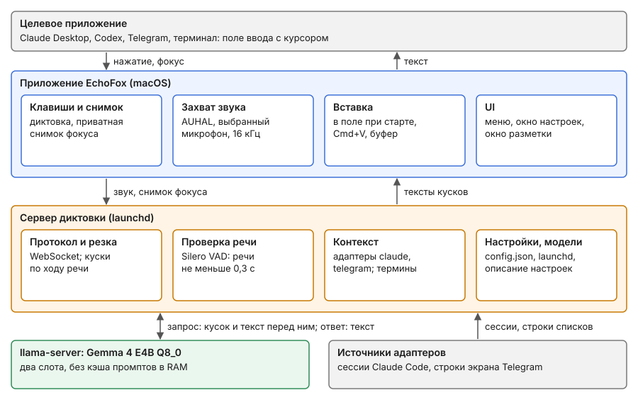

# 4. HLD

Архитектура по слоям. Ссылки FR и NFR — на вкладку [Requirements](2-requirements.md); интерфейс подробно — во вкладке [UI](5-ui.md). Что уже сделано, помечено «есть»; остальное — предложение, если не сказано иначе.

Стрелки — путь данных одной диктовки, сверху вниз; синим — приложение, оранжевым — сервер, зелёным — `llama-server` с моделью, серым — то, что вне Local Voice; масштаба у схемы нет.

## Слои

1. **Клавиши и индикатор** — приложение. Нажатие начинает и кончает запись (FR-1); в момент нажатия приложение делает снимок фокуса (см. «Разговор на экране»). Есть: одиночное нажатие правого ⌥, значок состояния в строке меню. Приватная диктовка — своим сочетанием (FR-2): снимок только поля ввода, на сервер он не уходит, запись не сохраняется. Индикатор — 3D-маскот (FR-14): прототип прозрачного рендера есть, маскота нет.
2. **Захват звука** — приложение. Есть: свой аудиоблок (AUHAL), привязанный к выбранному микрофону до запуска; 16 кГц, 16 бит, моно; кусками на сервер по ходу записи. Громкость входа — та же, что в системных настройках macOS.
3. **Транспорт** — один WebSocket к серверу на запись. Есть, протокол — в README: старт с моделью, языком и снимком; звук; стоп. В ответ признаки речи, тексты кусков, конец.
4. **Распознавание** — сервер и `llama-server`. Есть:
    - **Резка по ходу речи** (FR-3). Когда от прошлого реза набралось 20 с, кусок 12–15 с режется в самой тихой точке и сразу уходит модели; после стопа остаётся хвост 5–20 с.
    - **Проверка речи** (FR-4). Silero VAD находит речь в каждом куске; кусок, где её меньше 0,3 с, в модель не уходит. Текст длиннее 60 символов на секунду речи отбрасывается.
    - **Запрос.** Каждый кусок — отдельный запрос: шапка, контекст между `<context>` и `</context>`, промпт, звук. Пока пользователь говорит, общий текст прогревается в слотах `llama-server`; куски идут параллельно в два слота.
    - **Модель.** Gemma 4 E4B Q8\_0 с аудиопроектором BF16, в памяти одна модель (FR-7, NFR-7). `llama-server` без кэша промптов в RAM (`--cache-ram 0`). Сэмплинг — как советует Google: `temperature` 1.0, `top_k` 64, `top_p` 0.95.
5. **Адаптеры контекста** — сервер (FR-5, NFR-3). Есть. Ядро отдаёт запись одному адаптеру (см. «Разговор на экране»); адаптер находит сессию и отдаёт сообщения. Ядро строит контекст: последние сообщения в пределах бюджета токенов, сколько их брать целиком — настройка адаптера; термины — латинские слова и имена на других алфавитах; из сообщений остаются только строки прозы. Адаптеры — плагины; ядро не знает ни одного вендора. Встроены `claude` и `telegram`; подробно — документ [optional adapters](../adapters/1-idea.md).
6. **Вставка** — приложение. Есть: в поле, где был курсор при старте, через Accessibility или Cmd+V; если поле не принимает — в буфер обмена (FR-1). Предложение: текст ещё и в истории (FR-19, NFR-9).
7. **UI** — приложение: строка меню, окно настроек, окно разметки, установщик (FR-8 — FR-13, FR-17). UI ничего не делает сам: читает и пишет конфиг и спрашивает сервер. Описание настроек даёт сервер, раскладку на экране — приложение ([UI](5-ui.md#как-устроены-настройки)). Есть: меню и окно разметки.
8. **Установка и жизненный цикл** — сервер. Каталог поддерживаемых моделей (файл в репозитории), загрузка с прогрессом, агенты launchd для `llama-server` каждой модели, реестр в конфиге (FR-8, FR-21). Для UI — служебные команды сервера: каталог, установить, удалить, состояние. Есть: агенты launchd и реестр; каталога и установщика нет.
9. **Хранилище.** Есть: конфиг `~/.local-voice/config.json`, записи `~/speech/recordings`, разметка `~/speech/labeled`, метрики и журналы `~/Library/Logs/local-voice` (FR-16, FR-20).

## Процессы

- **Приложение** — один процесс: UI, клавиши, звук, вставка. Один процесс — одна запись в разрешениях macOS.
- **Сервер диктовки** — агент launchd; слои 4, 5, 8 и протокол.
- **`llama-server`** — агент launchd на каждую модель; работает только выбранная.

Сервер — внутри пакета приложения, вместе со своей средой Python и собранным `llama-server`; модель пользователь загружает из UI. Сборки: без модели и с каждой из моделей каталога. Обновления — через Sparkle.

Как собирать (предложение): модель не кладётся внутрь `.app` — пакет на 5–9 ГБ тяжело подписывать, нотаризировать и обновлять, и с каждым обновлением приложения пришлось бы заново качать модель. Сборка без модели качает её из UI в `~/Library/Application Support/Local Voice/models`; сборка с моделью — тот же `.app` и файл модели рядом в `.dmg`, приложение при первом запуске берёт модель оттуда. Для нотаризации подписывается каждый бинарник внутри пакета (Python, `llama-server`, onnxruntime).

Выпуск (предложение): код открыт на GitHub; сборку для раздачи подписываем сертификатом Developer ID (нужна платная Apple Developer Program) с усиленным рантаймом и правом на микрофон, нотаризуем (`notarytool`, `stapler`), раздаём `.dmg` в GitHub Releases; лента обновлений Sparkle (`appcast.xml`) подписана своим ключом EdDSA. С Developer ID разрешения macOS переживают обновления: требование к коду — bundle id и Team ID, а не хеш бинарника. Mac App Store не подходит: там обязательна песочница, а приложению в ней, насколько известно, Accessibility к чужим приложениям не даётся (не проверено). На время разработки — самоподписанный сертификат: с подписью ad hoc каждая пересборка меняла хеш, и macOS отказывала в уже выданном Accessibility (журнал `tccd`, 2026-10-15).

## Разговор на экране

Нажатие клавиши глобальное, а разговор у каждого целевого приложения свой. Поэтому работа делится на три шага:

1. **Снимок фокуса — ядро, приложение.** В момент нажатия приложение один раз и одинаково для всех собирает через Accessibility и систему: bundle id и pid фронтового приложения, заголовок окна, элемент с курсором и цепочку его родителей (роли, заголовки, описания, `AXDocument` или URL, если есть), процессы под окном и их рабочие папки. Снимок едет на сервер в `start`. Адаптеры сами на экран не смотрят: права Accessibility есть только у приложения, а снимок нужен мгновенно, пока фокус не ушёл. При приватной диктовке (FR-2) снимок на сервер не уходит.
2. **Выбор адаптера — ядро спрашивает все адаптеры.** У каждого адаптера дешёвая проверка «моё или нет» по снимку, с уверенностью. По одному приложению выбрать нельзя: в VS Code бывают и Claude Code, и Codex, в терминале — и `claude`, и `codex`. Ядро отдаёт запись самому уверенному; если не взял никто — диктовка без контекста.
3. **Сессия и контекст — только выбранный адаптер,** по тому же снимку и по своим источникам. Сессию адаптер находит только точно; угадывания нет, при неудаче — без контекста.

Следствие для NFR-3: снимок должен с самого начала быть достаточно полным, чтобы новым адаптерам хватало его без изменений приложения.

## Что даёт снимок: замер 2026-10-15 (факт)

Условия: этот Мак, macOS 27.0.1, Claude Desktop 2.37337.1, Ghostty, Telegram, Chrome; один снимок на приложение. VS Code не был запущен — не проверен.

- **Claude Desktop (Electron).** Без `AXManualAccessibility = true` у приложения видно только окно «Claude», элемента с курсором нет. С ним: элемент с курсором — `AXTextArea`, описание `Prompt`, классы DOM `tiptap ProseMirror`; на 26-м уровне вверх — веб-область с `AXURL = https://claude.ai/epitaxy/local_<id>` и `AXTitle = <название сессии> - Claude Code`.
- **Хранилище Desktop.** `~/Library/Application Support/Claude/claude-code-sessions/…/local_<id>.json` содержит `cliSessionId` (имя файла транскрипта), `cwd`, `title` и другое. Формат не документирован.
- **Ghostty (терминал).** Окно: заголовок `~`, `AXDocument = file:///Users/alex/` (рабочая папка оболочки). Элемент с курсором — `AXTextArea`, его значение — весь видимый буфер терминала. Под окном — дерево процессов (`login` → `zsh`) с рабочими папками.
- **Telegram.** Заголовок окна — название чата; элемент с курсором — `AXTextArea` «Write a message...».
- **Chrome.** `AXDocument` окна — URL активной вкладки; элемента с курсором нет.
- **Позиция текстового курсора** (`AXBoundsForRange`): Desktop — нулевой прямоугольник с x=0, Telegram — `0,0 1x0`, Ghostty — не отдаёт. Ни в одном приложении не годится.

## Адаптеры: как находят сессию

- **Claude, вкладка Code в Claude Desktop.** `AXURL` веб-области → `local_<id>` → запись сессии в хранилище Desktop → `cliSessionId` → `~/.claude/projects/<проект>/<cliSessionId>.jsonl`. Если записи в хранилище нет: заголовок веб-области совпадает с `custom-title` транскрипта — только когда такой транскрипт ровно один; иначе контекста нет. Из транскрипта берутся только финальные ответы Claude. Риск: формат хранилища не документирован и может смениться.
- **Telegram Desktop.** Строки списка сообщений над полем ввода из снимка (`screen: lists`); заголовок окна — название чата.
- **Codex и ChatGPT** (предложение, не сделано). Треды лежат в `~/.codex` (`state_5.sqlite`, `sessions/…/rollout-*.jsonl`); заголовок окна совпал с именем треда (одно наблюдение, 2026-10-18). Брать ответы с `phase: final_answer`.
- **Claude Code в терминале и VS Code** — не проверено.

## Следствия для ядра

- **Снимок включает** URL и заголовок ближайшей веб-области, `AXDocument` окна, классы DOM у родителей, процессы под окном и их рабочие папки — без значений полей (NFR-4). Для приложений адаптера с `screen: lists` — ещё строки списков окна (последние 150 строк каждого, до 30 тыс. символов) и рамку элемента в фокусе.
- **Электронным приложениям ядро включает `AXManualAccessibility`,** иначе они не отдают дерево. После включения элемент с курсором появился через 2,1 с (2087–2104 мс, три прогона, Claude Desktop 2.37337.1; факт). Поэтому приложение включает его заранее, когда Electron-приложение запускается или становится активным.

## Индикатор записи (FR-14)

3D-маскот поверх окна, где нажата клавиша: того же, куда пойдёт текст и откуда берётся контекст. Рамку окна даёт Accessibility (`AXPosition`, `AXSize`); Telegram Desktop и Claude Desktop её отдают (снимки 2026-10-18).

- **Рендер без фона** (проверено 2026-10-18 прототипом `macos/prototypes/transparent-realitykit-overlay.swift`: M5, macOS 27, один прогон, вокруг фигур видно окно, без рамки): `RealityRenderer` (RealityKit, macOS 15+) рисует сцену в нашу Metal-текстуру; каждый кадр текстура сначала очищается в цвет с альфой 0, камера рисует поверх (`cameraSettings.colorBackground = .outputTexture()`); текстура показывается в `CAMetalLayer` с `isOpaque = false` в панели `NSPanel` без рамки (`nonactivatingPanel`, фон `.clear`, `ignoresMouseEvents`, уровень над окнами, все рабочие столы). Панель не забирает фокус (NFR-8) и пропускает клики.
- **SceneKit не берём:** на WWDC25 Apple объявила его мягко устаревшим и советует новым проектам RealityKit.
- **Предложение, не сделано:** маскот — модель USDZ со скелетной анимацией (появиться, слушать, думать, готово, спрятаться, ошибка) и blend shapes лица; громкость голоса двигает лицо; «выглядывает из-за края» — край панели совмещён с краем окна; панель следует за окном по `AXObserver`; рисуем, только пока маскот виден; «Уменьшить движение» в macOS — статичная картинка.
- **Не проверено:** тень персонажа на прозрачном фоне, чистота альфы на сглаженных краях у сложной модели, нагрузка GPU на время записи.

## Состояние

- **Есть:** сервер (резка по ходу речи, проверка речи, адаптеры `claude` и `telegram`, контекст, метрики, записи); приложение (строка меню, клавиша, снимок, выбор микрофона и громкость, вставка, окно разметки); прототип прозрачного рендера маскота.
- **Дальше:** окно настроек и описание настроек от сервера ([UI](5-ui.md)), приватная диктовка, строка разрешений; потом установщик моделей, упаковка, адаптер Codex. Что ещё осталось — [Ideas](../ideas.md).

## Открытые вопросы

- Как найти сессию для Claude Code в терминале и в VS Code.
- Свободны ли одиночные нажатия правого ⌥ и правого ⌘ от системы и других приложений.
