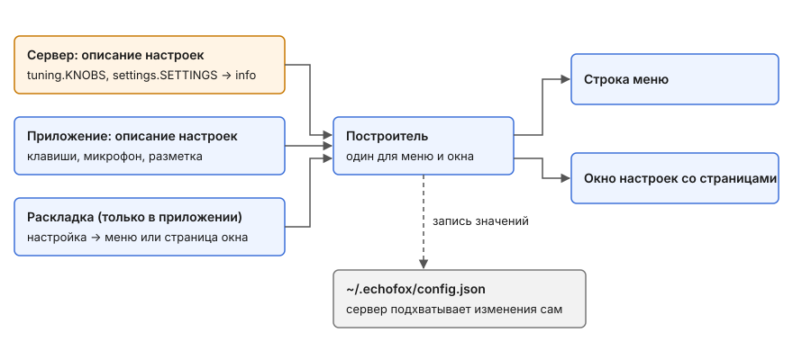

# 5. UI

Интерфейс приложения: строка меню, окно настроек, сочетания клавиш и то, как устроены настройки, чтобы их было легко переносить и добавлять. Требования — FR-10 — FR-13, FR-2, NFR-5 во вкладке [Requirements](2-requirements.md). Где UI стоит в архитектуре — [HLD](4-hld.md#слои).

## Принципы

- Диктовка — сочетанием клавиш, не из меню.
- В строке меню — только то, что пользователь трогает часто. Всё остальное — в окне настроек.
- UI ничего не решает сам: читает и пишет конфиг и спрашивает сервер. Сервер — бэкенд, UI его вызывает.
- Каждая настройка описана один раз; где она показана, решает одно поле (см. «Как устроены настройки»).

## Строка меню

**Значок** показывает состояние диктовки: ожидание, идёт запись (красный микрофон), ждём модель, проблема (перечёркнутый микрофон). Так сделано сейчас (`macos/Sources/LocalVoice/MenuBar.swift`).

**Меню**, сверху вниз:

1. **Разрешения.** Одна строка с подменю, по пункту на разрешение: «Универсальный доступ», «Микрофон». Выданное разрешение — серый неактивный пункт с галочкой. Невыданное — активный пункт; нажатие открывает нужное место в системных настройках. Строку видно и тогда, когда всё выдано.
    - Сейчас приложение открывает нужное место по адресу `x-apple.systempreferences:com.apple.preference.security?<раздел>` (`Permissions.swift`).
    - Предложение: в заголовке строки — итог, например «Разрешения: всё в порядке» или «Разрешения: нужен микрофон».
2. **Микрофон и громкость.** Подменю выбора микрофона и ползунок громкости входа. Предложение: рядом с ползунком — живой уровень сигнала.
3. **Label Recordings…** — окно разметки.
4. **Settings… (⌘,)** — окно настроек.
5. **Quit Local Voice.**

Так меню и сделано (`MenuBar.swift`, порядок — `SettingsLayout.menu`); Model, Language и Adapters перенесены в окно.

## Сочетания клавиш

| Действие | Что делает | Сейчас |
|---|---|---|
| Диктовка | Нажатие начинает запись, следующее — кончает; текст вставляется в поле, где был курсор при старте (FR-1). | одиночное нажатие правого ⌥ (`TapLogic.swift`) |
| Приватная диктовка | То же, но без чтения экрана (FR-2): приложение берёт только поле ввода, куда вставить текст; снимок фокуса на сервер не уходит, адаптеры не вызываются, контекста нет. Запись не сохраняется, её текст не попадает в журналы. Значок записи — фиолетовый. | одиночное нажатие правого ⌘ (по умолчанию; предложение) |

Оба сочетания настраиваются на странице General.

Почему правый ⌘ для приватной диктовки (предложение): тот же жест, что у обычной, и соседняя клавиша; срабатывает только нажатие одной клавиши без других, поэтому сочетания с правым ⌘ (⌘C и другие) его не задевают; двойное нажатие правого ⌥ добавило бы ожидание второго нажатия к каждому старту обычной диктовки. Известный конфликт: скрытая голосовая функция Claude Desktop — удержание правого ⌘; по умолчанию она выключена (`sableOtterEnabled: false` в коде Claude Desktop 2.42304, 2026-10-18). Предложение: окно проверяет, не занято ли сочетание другим действием Local Voice; занято ли оно системой или другим приложением — открытый вопрос: надёжного способа узнать это мы не проверяли.

Что видно во время приватной диктовки — предложение: тот же значок записи с отличием (например, другой символ), чтобы было понятно, что экран не читается.

## Окно настроек

Отдельное окно со страницами в боковой панели. Страницы идут по хозяевам настроек ([HLD](4-hld.md#настройки-у-каждой-свой-хозяин)): каждая настройка показана только на странице своего хозяина.

| Страница | Хозяин | Что на ней | Требования |
|---|---|---|---|
| General | приложение | Сочетания клавиш, остановка после тишины | FR-12, FR-1, FR-2 |
| Microphone | приложение | Микрофон, громкость; предложение: уровень сигнала, пробная запись | FR-1 |
| Language | язык | Язык диктовки; его пометки к промпту и слова-паразиты | FR-9 |
| Model | модель | Модель, её шаблон промпта, сэмплинг, длина ответа, контекст в system-ходе; потом — установка и удаление, память | FR-7, FR-8, FR-9 |
| Recognition | сервер | Резка на куски, пороги речи, проверка речи, предел записи | FR-3, FR-4, FR-9 |
| Adapters | адаптер | Раскрывается в боковой панели: под ним по строке на адаптер. Своя страница пункта — список адаптеров и «Defaults for all adapters» (`adapterDefaults`). Страница адаптера — вкл/выкл, что он читает, его настройки; у каждой видно, откуда значение: задано здесь, из общих или умолчание адаптера | FR-5, FR-6 |
| Recordings & Labels | сервер, приложение | Сохранять ли записи, папки записей и разметки; сколько размечено | FR-16, FR-17 |
| Diagnostics | — | Сервер, модель, ошибки, журналы | FR-20 |
| History | приложение | Последние тексты (FR-19), когда будет история | FR-19 |

У каждого поля — значение по умолчанию его хозяина и кнопка «сбросить», которая убирает правку из конфига.

## Как устроены настройки

Цель — NFR-5: настройку легко перенести между меню и окном и легко добавить. Ниже — предложение.

Описание настройки и её место на экране хранятся раздельно, а меню и окно строит один построитель; оранжевым — сервер, синим — приложение, серым — файл конфига, пунктир — запись значений; масштаба у схемы нет.

**Описание** — что это за настройка. Его даёт тот, кто её понимает:

- **Настройки сервера, моделей и адаптеров** — сервер, из своей таблицы (`server/tuning.py`, `KNOBS`, и `server/settings.py`, `SETTINGS`), с хозяином каждой. Он отдаёт их в ответе `info` (схема ниже). Новая ручка появляется в окне на странице своего хозяина без правки приложения.
- **Настройки приложения** (сочетания клавиш, микрофон, громкость, разметка) — приложение, из такой же таблицы в Swift.

**Раскладка** (`macos/Sources/LocalVoiceCore/SettingsLayout.swift`) — где настройка показана: в меню (порядок) или на странице окна (страница, раздел, порядок). Раскладка живёт только в приложении: это вопрос интерфейса, сервер о нём не знает. Перенести настройку между меню и страницей — поменять её строку в раскладке. Страница настройки сервера задана её хозяином; без строки в раскладке она попадает на эту страницу в раздел своей группы, чтобы новое никогда не терялось.

**Запись.** Окно пишет в `~/.local-voice/config.json` у хозяина: раздел `server`, `models.<модель>.options`, `adapters.<адаптер>` или `adapterDefaults`, `languages.<код>`. Оно меняет одно значение и сохраняет разметку файла (`JSONEdit.swift`). Сервер сам подхватывает изменения конфига (так работает сейчас). Неверное значение сервер сейчас пишет в журнал и не применяет: действует значение по умолчанию (`server/settings.py`, `file_settings`). Предложение: ошибку видно рядом с полем и на странице Diagnostics.

### Схема описания настройки в ответе `info`

`info` отдаёт `settings` — список описаний (протокол — в README):

| Поле | Тип | Что значит |
|---|---|---|
| `key` | строка | Имя в конфиге, например `pieceSeconds` |
| `owner` | `server`, `model`, `adapter` | Хозяин: где лежит правка пользователя — раздел `server`, `options` модели, запись адаптера |
| `group` | строка | Смысловая группа: `cutting`, `speech`, `recording`, `sampling`, `output`, `context`, `storage` |
| `kind` | `number`, `integer`, `boolean`, `string` | Тип значения |
| `min`, `max` | число | Диапазон, для чисел |
| `minExclusive`, `maxExclusive` | `true` | Значение не может быть равно границе |
| `default` | значение | Умолчание хозяина: для настройки модели — из каталога для модели из меню; для настройки адаптера — общее, а своё у каждого адаптера в `adapters[].context` |
| `value` | значение | Значение в силе у хозяина, если оно не по умолчанию |
| `help` | строка | Одна фраза: что делает |

Ещё в `info`: `adapters[].context` — умолчания каждого адаптера из манифеста; `languages[]` — `code`, `name`, `notes`, `fillers` (умолчания языка); `model` — `name`, `catalog` и `prompt` (шаблон каталога) модели из меню.

## Открытые вопросы

- Как узнать, что сочетание клавиш занято системой или другим приложением.
