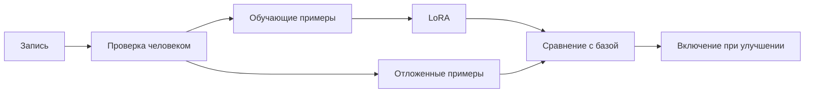

# Обучение на своих записях: идея

**Обучение ещё не реализовано.** В приложении уже можно слушать записи и исправлять текст. Следующий возможный шаг — использовать эти примеры для локального дообучения Gemma 4 E4B.

Цель — проверить, помогает ли обучение распознавать привычную лексику, смешанную речь и выдавать текст без запинок. Улучшение должно подтверждаться на записях, которые не участвовали в обучении.

Схема показывает план. Сейчас реализованы только сохранение и разметка.

## Что должен делать пользователь

1. По желанию сохранять обычные диктовки.
2. Прослушивать фрагменты и исправлять текст на тот, который хотел написать.
3. Явно запускать обучение на своём Mac.
4. Получать результат сравнения с базовой моделью и возможность вернуться к ней.

Всё аудио и тексты остаются на компьютере. Приватные диктовки не становятся обучающими данными.

## Что именно обучается

LoRA — небольшие дополнительные матрицы к выбранным слоям модели. Основные веса остаются неизменными. Полученный файл можно подключить и отключить.

Здесь «адаптер LoRA» означает файл обученных весов. Это другой вид адаптера, чем [плагин контекста приложения](../adapters/1-idea.md).

Обучающий пример содержит звук, промпт распознавания и проверенный текст. Контекст чата в обучение не входит: он меняется между разговорами и проверяется отдельно при оценке качества.

Эталон — «чистый» текст без запинок и повторов; после оговорки остаётся исправленная формулировка. В разметке это `"convention": "clean"`.

## Что уже известно, а что нужно измерить

Исследования персонализации речи и удаления запинок дают основания для эксперимента, но не доказывают пользу для Gemma на наших данных:

- [Shor et al., 2019](https://arxiv.org/abs/1907.13511) изучают адаптацию распознавания к дизартрической речи и акцентам.
- [Bannò et al., 2023/2024](https://arxiv.org/abs/2311.05550) сравнивают подходы к исправлению устной речи, включая удаление запинок на базе Whisper.

Результат EchoFox, необходимый объём разметки, время и память пока не измерены. Старые расчёты не следует превращать в обещание «модель выучит ваш голос за час».

## Как упростить разметку в будущем

Текущее окно показывает случайные неразмеченные фрагменты. Возможные улучшения:

- Предлагать короткую серию проверок, когда пользователь готов, без внезапных окон посреди работы.
- Разрешать подтверждение после прослушивания, чтобы уменьшить случайные нажатия.
- Выбирать сомнительные места вместо случайных, если вероятности токенов окажутся полезным сигналом.

Это предложения, не поведение текущего приложения. Отправленный в чат текст не считается правильной меткой автоматически: пользователь мог изменить смысл сообщения.

## Термины и следующие документы

**Отложенная выборка** — примеры только для проверки, не для обучения. **WER** — число замен, пропусков и вставок слов, делённое на число слов эталона.

[Требования](2-requirements.md) задают правила данных и проверки. [План реализации](3-hld.md) описывает компоненты, риски и первый эксперимент. Общий приоритет — в [плане работ](../ideas.md).
