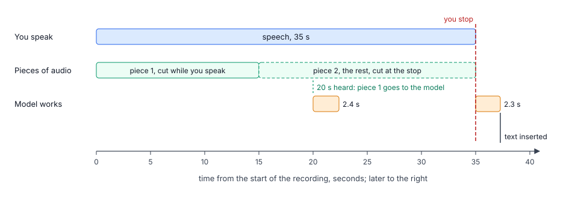

# Speech processing

The dictation server turns microphone audio into text. The Mac app handles recording and text insertion; the server handles speech detection, conversation context, and requests to the model.

<picture>
  <source media="(prefers-color-scheme: dark)" srcset="../../img/dictation-timeline-dark.svg">
  
</picture>

The server runs as the launchd agent `echofox.gemma-voice`, listening on `ws://127.0.0.1:8090`. It sends audio to a separate `llama-server` process, which runs Gemma 4 E4B on the Mac's GPU.

See also: [configuration](2-config.md), [conversation context](3-context.md), [protocol](6-protocol.md), and [development](7-development.md).

## From a recording to text

1. The app streams microphone audio: 16 kHz, 16-bit, mono.
2. Silero VAD detects speech as the audio arrives. A voice activity detector (VAD) distinguishes speech from silence. The server uses Silero v6.2.3 through onnxruntime.
3. Once 20 seconds have accumulated since the previous cut, the server finds the quietest point between seconds 12 and 15. It sends the completed piece to the model and keeps at least 5 seconds for the next piece.
4. When recording stops, the server splits the remaining audio into roughly 15-second pieces. No piece exceeds the model's 30-second input limit.
5. Pieces with less than 0.3 seconds of detected speech are skipped. This prevents the model from inventing text or copying context when the input is silent.
6. Each piece becomes a separate model request: conversation context, recognition prompt, and audio. Two requests can run at once.
7. The server removes configured hesitation sounds, such as “э” and “мм” in Russian, and returns the text in recording order.

While you speak, the server also prepares the shared context and prompt in the model's two processing slots. This reduces repeated work when the audio is ready. The server handles one recording at a time; a second waits for the first to finish.

Speech detection also drives the app's silence timeout. Audio levels are used to choose cut points and report recording quality, not to decide whether speech is present.

## Limit of a piece's text

A piece's text has at most 600 tokens (`maxTokensPerPiece` in the model's catalog entry). A token is a word or part of a word. The limit stops a model that does not end its text; without it, the model writes until its slot's context is full. The text that reached the limit is kept. In 798 speech pieces collected on 22–27 October 2026, Gemma 4 E4B wrote at most 10.4 tokens per second of speech; 600 is twice that for the longest piece the model takes, 30 seconds.

## Recognition prompt

The prompt combines the model's template with the language notes. The Gemma template is the speech recognition prompt of Google's model card with two additions: the speech comes from software engineers, so product names, services and abbreviations keep their official Latin spelling, and the text has punctuation and capital letters. It also asks for numbers as digits.

The language notes come in two parts, both in `server/languages.json`. The notes of every language (`"*"`) say that the speech mixes in English technical terms and that words of the language stay in its script. `{LANGUAGE}` in them is replaced with the language's name. English speech gets none of them, and its chat context gets no list of terms, since every English word would be one. Then come the notes of the language itself. The Russian notes say that the imperative mood stays as spoken and give examples of Russian words made from English ones (задеплоить, закоммитил). Hesitation sounds are listed only for Russian.

A custom model prompt replaces only the template. Language notes are still appended. The default sampling settings are temperature 1.0, top_k 64, and top_p 0.95.

## Models and memory

The model registry is stored in the config file. Each model has its own launchd agent, which the server writes; only the selected model runs. A change of the variant or the models folder restarts `llama-server` after the current recording. The catalog, the variants and the downloads are described [below](#the-catalog-and-the-downloads).

Gemma runs at `http://127.0.0.1:8092` with:

| Setting | Reason |
|---|---|
| 16,384-token context, split into two 8,192-token slots | Process two audio pieces concurrently. |
| All model layers on the GPU | Use Apple Silicon's GPU for inference. |
| `--swa-full` | Let later pieces reuse the shared prompt text. |
| `--cache-ram 0` | Disable the separate RAM prompt cache, which caused memory growth and swapping in a local run. |

Recognition makes only local connections; see [privacy](../design.md#privacy). Each setting has an owner ([design](../design.md#settings)); the cutting, the minimum speech and the output limit are constants in `server/tuning.py` and `server/catalog.json`, not settings.

### The catalog and the downloads

`server/catalog.json` has the variants, their files, the pinned revision of the source, the sizes and the SHA-256 of each file. The source of the current model is `ggml-org/gemma-4-E4B-it-GGUF` on Hugging Face; it needs no account. The files go to `~/Library/Application Support/EchoFox/models/gemma-4-E4B-it-GGUF/`; `server.modelsFolder` changes the root. A model's config entry names its catalog entry and can choose a `variant`; without one, the catalog's default applies. The server builds the arguments and the launchd agent of llama-server; a change of the active variant applies after the current recording.

The server, not the app's window, runs a download:

- it goes on when the window closes, and every connected client sees its progress;
- it resumes a part with an HTTP Range request;
- it checks the size and the SHA-256 before it renames the part;
- it keeps the files that another downloaded variant uses, and refuses to remove the active variant.

A download uses one connection per file: more connections were not faster on the measured link. The windows show the speed over the last 5 seconds and the time left (`TransferRate`), from the progress that the server sends every 0.5 seconds. The messages are in the [protocol](6-protocol.md#download-a-model). At the first start, the app recommends Q4_0 for a 16 GB Mac and Q8_0 for 24 GB or more.

## Code map

| File | Purpose |
|---|---|
| `gemma_voice.py` | Starts the server. |
| `protocol.py` | One connection of a client: reads its first message and hands it on. |
| `info.py` | The server's info: the models, languages, adapters and settings. |
| `variants.py` | The download and the removal of a model's variant. |
| `session.py` | One recording: the start message, the audio, the pieces, the context and the stop. |
| `audio.py` | The loudness of each 30 ms frame, the cuts, WAV files. |
| `vad.py` | Silero VAD on the audio as it arrives. |
| `dictation.py` | The prompt, the context and one request for each piece. |
| `llama.py` | The models in `llama-server` and their launchd agents. |
| `tuning.py` | The table of the settings and constants of a recording. |
| `settings.py` | The config file: reading, checking, updates from older versions. |
| `catalog.json`, `catalog.py` | The model catalog. |
| `languages.json`, `languages.py`, `fillers.py` | The languages: names, notes, hesitation sounds. |
| `adapters/` | The core of the adapters that give [the chat context](3-context.md), and the built-in adapters in `adapters/builtin/`. |
| `recordings.py` | [The recordings](5-recordings.md). |
| `metrics.py` | The metrics file and its summary. |
| `constants.py` | Shared constants, paths and names that the server, its scripts and its tests share. The ones the app also needs are in `shared/constants.json`, which the tests of both sides check. |

## Logs and metrics

- The log of the server is `~/Library/Logs/EchoFox/gemma-voice.log`. The log of `llama-server` is `~/Library/Logs/EchoFox/llama-server.log`.
- The server writes its metrics to `~/Library/Logs/EchoFox/gemma-voice-metrics.jsonl`, one JSON object on each line. Each request to the model has its tokens, speeds and times, the length of its audio and its speech, and the memory of `llama-server`. Each recording has its length and the wait after the stop.
- `server/.venv/bin/python server/metrics.py` prints a summary for each model and the last requests.
