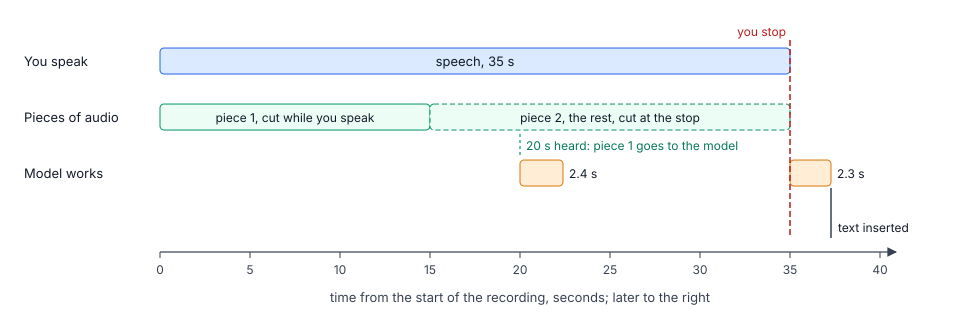

# Speech processing

The dictation server turns microphone audio into text. The Mac app handles recording and text insertion; the server handles speech detection, conversation context, and requests to the model.

<picture>
  <source media="(prefers-color-scheme: dark)" srcset="../../img/dictation-timeline-dark.svg">
  
</picture>

The server runs as the app's child process, listening on `ws://127.0.0.1:8090`. It sends audio to its own child process, `llama-server`, which runs Gemma 4 E4B on the Mac's GPU. The app starts the server with `echofox-server.py --parent`: the server ends when its standard input closes, that is when the app ends, and on SIGTERM, which the app sends at its quit. Before it ends, the server stops its llama-server. Its output goes to `~/Library/Logs/EchoFox/echofox-server.log`, llama-server's to `llama-server.log` next to it.

See also: [configuration](2-config.md), [conversation context](3-context.md), [protocol](6-protocol.md), and [development](7-development.md).

## From a recording to text

1. The app streams microphone audio: 16 kHz, 16-bit, mono.
2. Silero VAD detects speech as the audio arrives. A voice activity detector (VAD) distinguishes speech from silence. The server uses Silero v6.2.3 through onnxruntime.
3. A cut goes into a pause: at least 0.2 seconds without speech by the VAD (`minPauseSeconds`). The server looks for one between 8 and 25 seconds after the previous cut (`minPieceSeconds`, `maxPieceSeconds`) and takes the one nearest to 15 seconds (`pieceSeconds`). It cuts in the middle of the pause, once at least 5 more seconds are heard (`minLastPieceSeconds`) and no pause still to come could be nearer to 15 seconds. It sends the piece to the model. With no pause by 25 seconds, it cuts at the quietest 300 ms of that stretch.
4. When recording stops, the server splits the remaining audio into roughly 15-second pieces, each cut in the pause nearest to its equal point in the same way. No piece exceeds the model's 30-second input limit.
5. Pieces with less than 0.3 seconds of detected speech are skipped. This prevents the model from inventing text or copying context when the input is silent.
6. Each piece becomes a separate model request: conversation context, recognition prompt, and audio.
7. The server removes configured hesitation sounds, such as “э” and “мм” in Russian, and returns the text in recording order.

While you speak, the server also prepares the context and the prompt in the model's processing slot. This reduces repeated work when the audio is ready. The server handles one recording at a time; a second waits for the first to finish.

Speech detection also drives the app's silence timeout and finds the pauses for the cuts. Between the words of a phrase there is no pause: the level dips there for 30 to 150 ms, but it dips as much in the closure of a "п" or a "т" inside a word, and the VAD hears speech through both. Audio levels choose a cut only when no pause comes, and report recording quality.

## Limit of a piece's text

A piece's text has at most 600 tokens (`maxTokensPerPiece` in the model's catalog entry). A token is a word or part of a word. The limit stops a model that does not end its text; without it, the model writes until its slot's context is full. The text that reached the limit is kept. In 798 speech pieces collected on 22–27 October 2026, Gemma 4 E4B wrote at most 10.4 tokens per second of speech; 600 is twice that for the longest piece the model takes, 30 seconds.

## Recognition prompt

The prompt combines the model's template with the language notes. The Gemma template is the speech recognition prompt of Google's model card with two additions: the speech comes from software engineers, so product names, services and abbreviations keep their official Latin spelling, and the text has punctuation and capital letters. It also asks for numbers as digits.

The language notes come in two parts, both in `server/languages.json`. The notes of every language (`"*"`) say that the speech mixes in English technical terms and that words of the language stay in its script. `{LANGUAGE}` in them is replaced with the language's name. English speech gets none of them, and its chat context gets no list of terms, since every English word would be one. Then come the notes of the language itself. The Russian notes say that the imperative mood stays as spoken and give examples of Russian words made from English ones (задеплоить, закоммитил). Hesitation sounds are listed only for Russian.

A custom model prompt replaces only the template. Language notes are still appended. The default sampling settings are temperature 1.0, top_k 64, and top_p 0.95.

## Models and memory

The model registry is stored in the config file. The server starts the llama-server of the selected model when its `llamaServer` is on this Mac (`127.0.0.1` or `localhost`); a model on another computer is only asked. Only the selected model runs, and a llama-server that ended is started again at the next recording. A recording that asks for another model of the registry runs on it, and the server starts the selected model again within 2 seconds after that recording. If the selected model cannot start, for example because its files are missing, the server logs the reason once. It tries again every 2 seconds, so the model starts once its files are there. After `server.modelIdleSeconds` without a recording (600 s by default; 0 keeps the model in memory), the server ends the llama-server, and the model stays the selected one. A recording that finds it gone starts it first: the audio keeps coming and is cut into pieces, the context is read, and once the model answers the server sends the text before the audio and then the pieces. The log says how long the model took to load. A change of the variant or the models folder restarts `llama-server` after the current recording. The catalog, the variants and the downloads are described [below](#the-catalog-and-the-downloads).

Gemma runs at `http://127.0.0.1:8092` with:

| Setting | Reason |
|---|---|
| One slot with a 32,768-token context | Room for a large open file and the conversation beside the longest audio and the answer. The model takes 131,072 tokens (`gemma4.context_length` in its file). One slot is enough: a dictation's pieces go one after the other, the pieces cut while you speak are done before the stop (1,769 of 2,534 recordings to 2026-11-02 had one piece), and a piece reuses the text before the audio that the slot already holds. |
| All model layers on the GPU | Use Apple Silicon's GPU for inference. |
| `--swa-full` | Let later pieces reuse the shared prompt text. |
| `--cache-ram 0` | Disable the separate RAM prompt cache, which caused memory growth and swapping in a local run. |

Recognition makes only local connections; see [privacy](../design.md#privacy). Each setting has an owner ([design](../design.md#settings)); the cutting, the minimum speech and the output limit are constants in `server/tuning.py` and `server/catalog.json`, not settings.

### The catalog and the downloads

`server/catalog.json` has the variants, their files, the pinned revision of the source, the sizes and the SHA-256 of each file. A catalog entry names its source, and a variant can name its own (`catalog.source`). The default variant, Q4_0, is Google's quantization-aware trained file from `google/gemma-4-E4B-it-qat-q4_0-gguf`. Q8_0 comes from the entry's source, `ggml-org/gemma-4-E4B-it-GGUF`. Both repositories are on Hugging Face and need no account. The files of a variant go to a folder named after its source repository, for example `~/Library/Application Support/EchoFox/models/gemma-4-E4B-it-qat-q4_0-gguf/`; `server.modelsFolder` changes the root. A model's config entry names its catalog entry and can choose a `variant`; without one, the catalog's default applies. The variant that runs is the chosen one if its files are in the models folder, else the default if its files are there, else the first downloaded variant of the catalog (`catalog.in_force`). So a new default, or a removed variant, never leaves the model without files while another variant is downloaded. With no variant downloaded, the app's menu bar shows that no model is downloaded. The server builds the arguments of llama-server; a change of the active variant applies after the current recording. A catalog entry also gives the fields that every request to its llama-server carries: Gemma's turns off the model's thinking (`enable_thinking: false`), which otherwise spent a piece's whole token limit before any text.

The server, not the app's window, runs a download:

- it goes on when the window closes, and every connected client sees its progress;
- it resumes a part with an HTTP Range request;
- it checks the size and the SHA-256 before it renames the part;
- a removal keeps the files that another downloaded variant uses. A removal of the variant that the running llama-server uses waits for the running recording, then takes the model out of memory.

A download uses one connection per file: more connections were not faster on the measured link. The windows show the speed over the last 5 seconds and the time left (`TransferRate`), from the progress that the server sends every 0.5 seconds. The messages are in the [protocol](6-protocol.md#download-a-model). At the first start, the app recommends the catalog's default variant if its memory is at most half of the Mac's memory, else the biggest variant that fits in half, else the smallest.

## Code map

| File | Purpose |
|---|---|
| `echofox-server.py` | Starts the server. |
| `protocol.py` | One connection of a client: reads its first message and hands it on. |
| `info.py` | The server's info: the models, languages, adapters and settings. |
| `variants.py` | The download and removal messages of a model's variant. |
| `downloads.py` | The downloads of a variant's files, their removal, and the list of a model's variants for the info. |
| `session.py` | One recording: the start message, the audio, the pieces, the context and the stop. |
| `resolve.py` | The options of a recording and of an adapter's context, from the owners of each setting. |
| `audio.py` | The loudness of each 30 ms frame, the cuts, WAV files. |
| `vad.py` | Silero VAD on the audio as it arrives. |
| `dictation.py` | One request to the model for each piece, and the hesitation sounds taken out of its text. |
| `prompt.py` | The text before the audio: the context within its token budgets, then the prompt. |
| `blocking.py` | A model request in a thread, which a cancelled recording stops. |
| `budget.py` | The estimate of a text's tokens from its characters, and the budgets of the context. |
| `model_registry.py` | The registry of models: the selected model, which model is in memory, the idle unload, one recording at a time (`Models.in_use`). |
| `llama_process.py` | The process of `llama-server`: its command, its start and end, the wait until it answers, its memory. |
| `llama_client.py` | The HTTP client of `llama-server`: tokens, the warm-up of a slot, one piece's text, the timings. |
| `tuning.py` | The table of the settings and constants of a recording, and their checks. |
| `settings.py` | The config file: reading, checking, updates from older versions, and the watcher that applies its changes. |
| `catalog.json`, `catalog.py` | The model catalog: a model's files, defaults and request fields. |
| `languages.json`, `languages.py`, `fillers.py` | The languages: names, notes, hesitation sounds. |
| `adapters/` | The core of the adapters that give [the chat context](3-context.md), and the built-in adapters in `adapters/builtin/`. |
| `recordings.py` | The files of [a recording](5-recordings.md). No other module writes into a recording's folder. |
| `microphone.py` | The Mac's input volume and input device, for a saved recording's record. |
| `metrics.py` | The metrics file. |
| `tools/` | The tools of development: the test server, the test client, the metrics' summary and others. |
| `constants.py` | Shared constants, paths and names that the server, its scripts and its tests share. The ones the app also needs are in `shared/constants.json`, which the tests of both sides check. |

## Logs and metrics

- The log of the server is `~/Library/Logs/EchoFox/echofox-server.log`. The log of `llama-server` is `~/Library/Logs/EchoFox/llama-server.log`.
- The server writes its metrics to `~/Library/Logs/EchoFox/echofox-server-metrics.jsonl`, one JSON object on each line. Each request to the model has its tokens, speeds and times, the length of its audio and its speech, and the memory of `llama-server`. Each recording has its length and the wait after the stop.
- `server/.venv/bin/python server/tools/metrics_summary.py` prints a summary for each model and the last requests.
