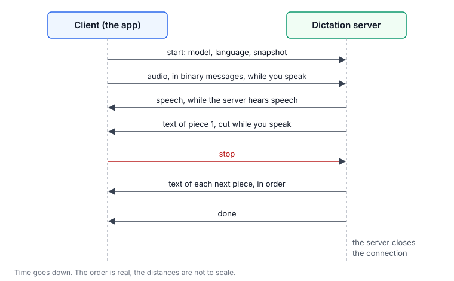

# The protocol

A client and [the dictation server](1-server.md) talk over one WebSocket, `ws://127.0.0.1:8090`. A connection is one recording, one question about the server, or one download or removal of a model. `shared/protocol-examples.json` has an example of every message. `server/test_contract.py` and the app's `lv-tests` both check them.

## A recording



The client sends the audio while you speak, and the server sends the texts of the pieces in their order.

1. The client sends the start message:

   ```json
   {"type": "start", "model": "<name>", "language": "ru", "sampleRate": 16000, "encoding": "pcm_s16le",
    "client": "<name>", "snapshot": {…}, "hints": {…}}
   ```

   - `snapshot` is the focus snapshot (see [the chat context](3-context.md)). `hints` is what the client knows. It goes to the adapters as it is.
   - Without `model`, the server takes the first model of the registry.
   - `"private": true` makes a private dictation: the server saves nothing, runs no adapter and writes no text into its log. The app sends no snapshot with it.
   - An experiment can also send `prompt` and `options`. They win over the settings of the model. The app never sends them.
2. The client sends the audio in binary messages: 16-bit little-endian PCM, 16 kHz, mono.
3. When the recording stops, the client sends `{"type": "stop", "reason": "user"}`. The other reasons are `silence`, `max_duration` and `error`.

The server sends:

| Message | When |
|---|---|
| `{"type": "speech"}` | While it hears speech. |
| `{"type": "stopped", "reason": "max_duration"}` | The recording reached its time limit. The server takes no more audio. |
| `{"type": "text", "text": "…"}` | A piece is done. The texts come in the order of the pieces. |
| `{"type": "error", "message": "…"}` | Something went wrong. A text message that is not a JSON object is an error, and the recording goes on. |
| `{"type": "done"}` | After the last piece. Then the server closes the connection. |

## A question about the server

Instead of the start message, the client can send `{"type": "info"}`. The server answers and closes the connection:

```json
{"type": "info", "interface": 2, "adapterInterface": 2, "sampleRate": 16000, "encoding": "pcm_s16le",
 "textWaitSeconds": 180, "maxRecordingSeconds": 1800,
 "languages": [{"code", "name", "notes", "fillers"}],
 "adapters": [{"name", "enabled", "builtin", "version", "author", "source", "description", "apps",
               "electronTree", "reads", "screen", "context", "error"}],
 "models": ["<name>"],
 "model": {"name", "catalog", "prompt", "maxAudioSeconds", "variant",
           "variants": [{"id", "name", "bytes", "memoryBytes", "downloaded", "downloading"}]},
 "settings": [{"key", "owner", "group", "kind", "title", "advanced", "default", "value", "min", "max",
               "minExclusive", "maxExclusive", "help"}]}
```

The app takes from it the format of the audio, the wait for the text, the time limit of a recording, the languages, the adapters, the menu's model and the settings. `models` are the names of the registry. `model.variants` are the quantizations of the menu's model: the size of the files of each, its memory while it is loaded, whether its files are all in the models folder, and whether they download now. `model.variant` is the one in force.

`settings` describes each setting that the settings window can show and change:

| Field | What it means |
|---|---|
| `owner` | Where the value goes: `server` (the section `server` of the config), `model` (the model's `options`) or `adapter` (the adapter's entry). |
| `kind` | `number`, `integer`, `boolean` or `string`. |
| `title`, `help` | The name and the description in the window, in plain English for the user. `help` is empty when the title says it all. |
| `advanced` | Present for a setting of the Advanced section. |
| `default` | The default of the owner. For an adapter setting, the default of each adapter is in its `context`. |
| `value` | Present only when the value in force is not the default. |
| `min`, `max` | The range of a number. `minExclusive` and `maxExclusive` mean that the value cannot be equal to the bound. |

The constants of the server are not settings and are not in this list.

## Download a model

The client sends `{"type": "download", "catalog": "gemma-4-e4b", "variant": "q4_0"}`. The server downloads the files of that variant that are not in the models folder yet. The URL, the size and the SHA-256 of each file are in `server/catalog.json`.

| The server sends | When |
|---|---|
| `{"type": "progress", "bytes": 1048576, "total": 5582359648}` | At most every 0.5 s. `bytes` counts the files that are already there too. |
| `{"type": "downloaded"}` | All files of the variant are there. Then the server closes the connection. |
| `{"type": "error", "message": "…"}` | The download stopped. Then the server closes the connection. |

- The download goes on when the connection closes. Another `download` message for the same variant joins it and gets its progress.
- `{"type": "cancel"}` on the connection stops the download. What is downloaded stays, and the next download goes on from there.
- A file is written as `<file>.part`. It gets its own name only when its size and its SHA-256 are right. A wrong SHA-256 deletes the part and stops the download with an error.
- The server refuses a download when the disk has less free space than the rest of the files and 1 GB more.

## Remove a model

The client sends `{"type": "remove", "catalog": "gemma-4-e4b", "variant": "q4_0"}`. The server deletes the files of that variant that no other downloaded variant uses. It refuses to remove the variant in force of the menu's model. It answers `{"type": "removed", "bytes": 4590807392}` or an error, and closes the connection.
